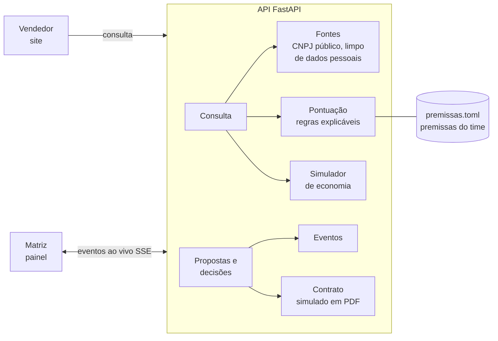

# CredFácil

Consulta de crédito e de maquininha para o vendedor de campo: a partir do CNPJ de um pequeno comerciante, mostra quanto ele pode economizar em taxas, uma faixa de risco com o porquê de cada ponto, e envia a proposta para a matriz, que recebe tudo ao vivo.

Projeto do time **ResenhaAI vs EntrosaGPT** no Hack Brasil 2026, trilha **Pagamentos & finanças**.

> **Simulação. Não é oferta de crédito.** Limite, taxas, aprovação e contrato são simulações para demonstração. A economia é uma estimativa feita com dados informados pelo comerciante.

**Demo:** https://credfaciil.netlify.app · **Vídeo:** _a publicar até 29/11_ · **Painel da matriz:** https://credfaciil.netlify.app/matriz/

## Em 30 segundos

- **Para quem:** o vendedor de campo de uma credenciadora (quem oferece maquininhas) e o pequeno comerciante que ele atende. O comerciante é o beneficiário: espera menos por uma resposta e vê, em reais, quanto deixaria de pagar em taxas.
- **O que faz:** o vendedor digita o CNPJ e o faturamento. Se quiser, informa também como o comerciante recebe hoje (débito, crédito, Pix) e quanto paga. Em segundos aparecem a economia por mês e por ano, a faixa de risco com os fatores, a máquina indicada e um limite simulado. Um clique envia a proposta, e a matriz a recebe ao vivo, sem recarregar a página, podendo aprovar, recusar ou pedir pendência. Ao aprovar, sai um contrato simulado em PDF.
- **Como:** dados públicos de empresas, regras explicáveis (sem caixa-preta e sem IA no cálculo) e interface pensada para acessibilidade (WCAG 2.1 AA).

## Experimente a demo

1. Abra https://credfaciil.netlify.app. Se a página demorar no primeiro acesso, espere: a API gratuita "acorda" em até um minuto.
2. No formulário "Seu próximo passo começa aqui", abra **Comparar com a maquininha atual** e clique em **Preencher com o exemplo do mercadinho (fictício)**.
3. Clique em **Analisar**. A tela de resultado mostra a economia estimada, a faixa de risco com os fatores, a recomendação e as fontes.
4. Em outra aba, abra o **painel da matriz** (https://credfaciil.netlify.app/matriz/).
5. Volte à primeira aba e, em "Enviar proposta à matriz", clique em **Enviar proposta**. A proposta aparece no painel na hora.
6. No painel, **peça uma pendência** ou **aprove**. Aprovada, a proposta ganha o link do **contrato simulado em PDF**.

Enquanto as premissas da pontuação não forem aprovadas pelo time (`api/premissas.toml`), a consulta avisa isso no passo 3. Um exemplo ilustrativo da tela de resultado fica em https://credfaciil.netlify.app/resultado/?exemplo.

A demo só aceita os CNPJs da lista de demonstração (`fixtures/cnpjs_demo.json`): três comerciantes **fictícios** (mercadinho, salão e loja de material de construção) e quatro estatais grandes, cujos dados públicos servem para mostrar a consulta à fonte. Outro CNPJ recebe um aviso claro.

## O problema

Quem vende maquininha e crédito para pequenos comerciantes perde tempo avaliando o cliente, conversa com a mesa de análise por canais soltos e usa ferramentas pouco acessíveis. O comerciante espera, e muitas vezes continua pagando uma taxa mal ajustada ao jeito como ele vende. Não temos números de mercado próprios sobre essa demora; por isso não citamos nenhum.

## Como funciona por dentro



- **Site:** Next.js e TypeScript, exportado como páginas estáticas e publicado no Netlify. Os tipos da API são gerados do contrato (OpenAPI), nunca escritos à mão.
- **API:** FastAPI (Python), publicada no Render. Contrato em [`docs/ARQUITETURA.md`](docs/ARQUITETURA.md) e em `api/openapi.json`.
- **Pontuação** (`api/scoring/`) e **simulador** (`api/recomendacao/`): funções puras, sem rede, banco ou IA. Mesma entrada, mesma saída, com testes para cada regra.
- **Premissas** (pesos, faixas, limite, antecipação e catálogo de máquinas) ficam em [`api/premissas.toml`](api/premissas.toml), com o motivo de cada número escrito ao lado. Elas só valem depois de aprovadas pelo time.
- **Tempo real:** Server-Sent Events. A proposta enviada chega ao painel em dezenas de milissegundos nos nossos testes.
- **Armazenamento:** em memória, com limites. Propostas somem quando a API reinicia. Para uma demonstração isso basta; um banco de dados é o próximo passo.

## Por que confiar nos números (e o que eles não são)

- **Tudo é simulação.** O aviso aparece em todas as telas, no PDF e nas respostas da API.
- **A pontuação é por regras, não por um modelo treinado.** Cada fator aparece com quantos pontos somou ou tirou. As premissas são **escolhas do time, não estatística**: não há dado real de inadimplência para validá-las, e não prometemos precisão.
- **A economia é uma estimativa** feita com o que o comerciante informa (faturamento, mix de pagamento e taxas de hoje). Sem esses dados, o sistema diz que não dá para comparar, e não inventa um valor.
- **Nenhuma taxa é assumida.** Se falta a taxa de uma forma de pagamento que tem vendas, o simulador para e pede, em vez de supor zero.
- **O catálogo de máquinas é fictício e sem marca real.** As taxas da oferta vêm do caso de referência do próprio projeto ([`docs/PRODUTO.md`](docs/PRODUTO.md), RF-11): R$ 15 mil por mês dá economia de R$ 169,80 por mês. É exatamente o exemplo do mercadinho da demo.
- **Nenhum cálculo usa IA.** IA foi usada para escrever código e documentos, com revisão (ver abaixo).

## Dados e privacidade

- A fonte de dados de empresa é a API pública de CNPJ (open.cnpja.com), consultada com endereço fixo, tempo-limite e CNPJ validado antes de qualquer chamada. A resposta traz sócios (com CPF mascarado), e-mails, telefones e endereço: **tudo isso é descartado na entrada**, e só ficam situação cadastral, atividade, porte, abertura, capital social e cidade. Para empresas que podem ser uma pessoa (MEI, LTDA de um dono só, empresário individual), o nome também é escondido.
- Os **CNPJs fictícios** da demo têm dígitos válidos e foram **conferidos como inexistentes** na fonte pública, para nenhum cair, sem querer, em uma empresa real ou em um MEI. O script `scripts/gerar_cnpj_ficticio.py --conferir` refaz essa conferência.
- Os campos de texto livre (observações, pendências) recusam texto com cara de dado pessoal (e-mail, CPF, telefone), porque a demo é pública.
- Detalhes, limites de uso e datas dos testes em [`docs/DADOS.md`](docs/DADOS.md).

## Acessibilidade

Meta: WCAG 2.1 nível AA ([`docs/ACESSIBILIDADE.md`](docs/ACESSIBILIDADE.md)).

- **Testado automaticamente** em todas as telas, no computador e no celular: verificação com axe (zero violações WCAG 2.1 A e AA), uso só com teclado, foco visível e página sem rolagem horizontal.
- **No código:** rótulo visível em todo campo; erros ligados ao campo, anunciados e com o foco levado até ele; resultado e propostas novas anunciados para leitor de tela sem roubar o foco; status sempre em texto, nunca só por cor; contraste conferido em cada par de cores (quatro tons do protótipo foram escurecidos para passar); respeito a "reduzir movimento" e um interruptor na página.
- **Ainda não testado:** leitor de tela de verdade (NVDA ou VoiceOver) e zoom de 200% feito à mão.

## Como rodar localmente

O projeto tem duas partes: a API (Python, pasta `api/`) e o site (Next.js, pasta `web/`).

### API

Precisa de Python 3.12 ou mais novo. Da raiz do repositório:

```powershell
# Windows (PowerShell). Se "python" não for reconhecido, troque por "py".
python -m venv .venv
# Só na primeira vez, se o PowerShell disser que a execução de scripts está desabilitada:
Set-ExecutionPolicy -Scope CurrentUser RemoteSigned
.venv\Scripts\Activate.ps1
pip install -r api/requirements-dev.txt
```

```bash
# macOS e Linux
python3 -m venv .venv
source .venv/bin/activate
pip install -r api/requirements-dev.txt
```

Com o ambiente ativado, sempre a partir da raiz do repositório:

| Para quê | Comando |
| --- | --- |
| Subir a API em http://localhost:8000 | `cd api; python -m uvicorn app.main:app --reload` |
| Ver e testar as rotas no navegador | abrir http://localhost:8000/docs |
| Rodar lint, formatação e todos os testes da API | `python scripts/verificar.py` |
| Regenerar `api/openapi.json` depois de mudar o contrato | `python scripts/exportar_openapi.py` |

Configuração: a API lê do ambiente, não do arquivo `.env`.
- `MODO_DEMO` (padrão `true`): só aceita os CNPJs da lista de demonstração.
- `CORS_ORIGENS` (padrão `http://localhost:3000`): endereços do site que podem chamar a API.

No PowerShell: `$env:MODO_DEMO="false"`. No macOS e Linux: `export MODO_DEMO=false`.

A consulta completa só funciona com `status = "aprovada"` em `api/premissas.toml`. Com `"proposta"`, ela responde que aguarda a aprovação das premissas do time.

### Site

Precisa de Node.js 22. Em outro terminal, a partir da raiz:

```bash
cd web
npm install
npm run dev
```

Abra http://localhost:3000. O site chama a API em `http://localhost:8000`; para outro endereço, copie `web/.env.example` para `web/.env.local` e ajuste `NEXT_PUBLIC_API_URL`.

| Para quê | Comando (dentro de `web/`) |
| --- | --- |
| Conferir o código (lint, inclui regras de acessibilidade) | `npm run lint` |
| Gerar a versão de produção (páginas HTML prontas em `web/out/`) | `npm run build` |
| Ver a versão de produção no navegador (depois do build) | `npm run start` |
| Testes no navegador, com axe (rode o build antes) | `npm run e2e` |
| Atualizar os tipos da API depois de mudar o contrato | `npm run tipos` |

Os testes no navegador usam o Playwright. Na primeira vez, instale o navegador com `npx playwright install chromium`.

Publicação (Render e Netlify): [`docs/DEPLOY.md`](docs/DEPLOY.md).

## Estrutura

```
api/            API em FastAPI
  app/          rotas, contrato (schemas), consulta, contrato em PDF, memória
  fontes/       fonte pública de CNPJ e limpeza de dados pessoais; lista da demo
  scoring/      pontuação por regras (função pura) e leitura das premissas
  recomendacao/ simulador de economia (função pura)
  premissas.toml premissas do time (pesos, faixas, catálogo)
  tests/        testes da API
web/            site em Next.js (landing, resultado, painel da matriz) e testes Playwright
fixtures/       CNPJs da demo e dados de empresa já sem dado pessoal
scripts/        verificação, OpenAPI, geração de dados da demo
docs/           produto, arquitetura, dados, decisões, status, deploy
```

## Estado atual e próximos passos

O escopo foi congelado em 23/11. O que está pronto: consulta, resultado com economia e fatores, envio da proposta, painel da matriz ao vivo, pendência, aprovação, recusa e contrato simulado em PDF. O andamento de cada item está em [`docs/STATUS.md`](docs/STATUS.md).

Ficou de fora do MVP e é próximo passo:
- ditado do CNPJ por voz e a tela "Entrar na demonstração" (escolher entre vendedor e matriz);
- o vendedor ver, na própria tela, a pendência pedida pela matriz;
- banco de dados (hoje as propostas ficam em memória) e consulta ao vivo à fonte com cache e plano B quando ela cai;
- referência de mercado do Banco Central para comparar a taxa do comerciante;
- validar as premissas da pontuação com dados reais, o que hoje não temos.

## Como usamos IA

Usamos agentes de código (principalmente o Claude Code) com regras escritas para o projeto, que valem para qualquer ferramenta: [`AGENTS.md`](AGENTS.md), skills e agentes de revisão em [`.claude/`](.claude) e o guia [`docs/IA.md`](docs/IA.md). Na prática:

- toda mudança passou por testes automáticos e por agentes revisores (qualidade, segurança e privacidade) antes do pull request, e por revisão humana antes de entrar na `main`;
- as regras proíbem IA no cálculo de pontuação, limite, taxa ou economia, dado pessoal real e número inventado apresentado como real;
- os agentes revisores encontraram problemas de verdade, que foram corrigidos antes do merge: por exemplo, um CNPJ usado como "fictício" que na verdade era de uma associação real, uma regra de privacidade que deixaria aparecer o nome do dono de uma LTDA, e um PDF que quebraria com travessão ou aspas digitados no celular.

## Equipe

Felipe, Guilherme, Kayke e Amanda.

## Licença

A definir (ver [`docs/DECISOES.md`](docs/DECISOES.md), D-010).

---

**English summary.** CredFácil helps field sales agents who sell card terminals to small merchants. From a company tax ID (CNPJ) and the merchant's monthly revenue, and optionally how they get paid today and what they pay, it shows the estimated monthly and yearly savings in fees, an explainable rule-based risk band, a recommended terminal and a *simulated* credit limit. One click sends the proposal to a back-office panel that receives it live (Server-Sent Events) and can approve, refuse or ask for documents; approval produces a *simulated* contract PDF. Company data comes from a public CNPJ API with all personal data dropped on the way in; demo merchants are fictitious and checked not to exist. No AI is used in any calculation, the scoring premises are team assumptions rather than statistics, and everything about credit is a simulation. The interface targets WCAG 2.1 AA and is tested with axe, keyboard-only use and mobile layouts.
